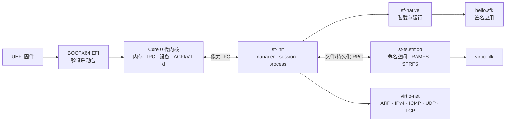

# SpiritFoxOS

[](https://github.com/fwqfzqaz/SpiritFoxOS/actions/workflows/linux.yml)
[](https://github.com/fwqfzqaz/SpiritFoxOS/actions/workflows/windows.yml)
[](docs/design/DESIGN-v0.2.md)
[](docs/project/ROADMAP.md)
[](LICENSE)

面向 x86_64 UEFI 的**微内核操作系统原型**。Core 0 只保留内存、IPC、设备与 ACPI/VT-d；文件系统、持久化、驱动、native 运行时和网络协议运行在 ring-3 的 `.sfmod` 中；应用以签名 `.sfk` 包从只读磁盘验证后装载。

> 这是研究型原型，不是生产系统。M0–M7 纵向切片已完成，下一阶段为 `v0.3` 模块化收尾与运行时加固，见[路线图](docs/project/ROADMAP.md)；完整边界见[实现说明](docs/architecture/IMPLEMENTATION.md)。

## 亮点

| 能力 | 当前状态 |
| --- | --- |
| 启动与隔离 | UEFI 验证签名启动包，ExitBootServices 后进入独立页表的 CPL3 `sf-init` |
| 调度 | SMP（MADT/LAPIC/IPI，最多 8 核）、同进程多线程、抢占、0–3 基础优先级、等待老化与 CPU 时间预算，PID 1 控制配置 |
| 内核句柄配额 | PID 1 可配置每任务 0–32 个能力句柄，默认 32，保留既有引用 |
| 私有池页面配额 | 根任务显式预算创建、上限/占用查询，默认4096页，计入私有页和新页表 |
| 包格式 | 96 字节头 + 64 字节段描述符 + 确定性 CBOR + Ed25519 尾部，W^X 与段布局校验 |
| 微内核边界 | 内核不解析路径、ELF、CBOR 或包格式；驱动与服务均为用户态模块 |
| 存储 | legacy/modern `virtio-blk`、SFRFS1/SFRFS2 自动探测、独立 `sf-fs.sfmod`、双银行事务持久化、掉电故障恢复 |
| 更新与信任 | 应用 A/B 试运行、健康确认与回退、用途受限公钥、持久化密钥撤销、版本下限 |
| DMA 隔离 | QEMU q35 Intel VT-d，按设备授予有界 IOVA，拒绝越界 DMA |
| native 运行时 | static 与 `relative-v1` 位置无关装载、私有映像、有界 argv/env、单一认证运行时库的按名导入与有界 POSIX 子集 |
| 文件 SDK | 有界 C 客户端封装文件 RPC，支持规范句柄、元数据、固定截止时间与只读目录委派 |
| 网络切片 | ring-3 legacy `virtio-net`、IOAPIC INTx、DHCP、ARP/IPv4/ICMP、UDP/TCP、有界连接对象与 `/net` 投影 |
| 多用户会话 | 构建期账户、四个有界控制台会话、uid/gid 所有者权限与管理员命令门 |
| 双语言实现 | C + Rust：SHA-256、参数打包、网络帧、调度策略四个纯逻辑组件以 no_std Rust 实现（[语言分工](docs/architecture/LANGUAGE.md)） |

## 架构



设计目标是“内核机制最小化、策略与服务用户态化”。`sf-init` 保留管理、会话与进程策略；文件与持久化语义由独立 ring-3 服务承载。协议边界仍以 IPC 与文件 RPC 保持。详见[设计说明 v0.2](docs/design/DESIGN-v0.2.md)与[实现边界](docs/architecture/IMPLEMENTATION.md)。

## 快速开始

环境：Linux x64（使用系统 QEMU 与 OVMF），或 Windows x64 + Python 3.11+。工具链、缓存和密钥都在仓库内，无需全局安装或修改 `PATH`。Rust 组件需要 rustup 与目标 `x86_64-unknown-none`、`x86_64-pc-windows-gnu`（Linux CI 另需 `x86_64-unknown-linux-gnu`），详见[语言分工](docs/architecture/LANGUAGE.md)。

包作者可使用独立 `native-source-v1` schema 和无需密钥的离线清单检查；源文件界限与 `--strict-manifest` 用法见[清单说明](docs/architecture/MANIFESTS.md)。

```bash
python3 tools/bootstrap.py     # 下载并校验 Zig 0.13.0 与 Monocypher
rustup target add x86_64-unknown-none x86_64-pc-windows-gnu   # Rust 组件所需
python3 tools/test.py          # 构建 + 宿主/集成/QEMU 全量测试
```

常用变体：

```bash
python3 tools/build.py                 # 只构建
python3 tools/test.py --host-only      # 只跑宿主测试
python3 tools/test.py --skip-build     # 复用已有镜像
```

根目录 [Makefile](Makefile) 是同一套 Python 命令的薄封装：

```bash
make build          # 构建 EFI、模块、应用与测试盘
make test           # 完整测试
make run            # 交互启动
make run-persist    # 可写持久盘
make run-iommu      # 启用 VT-d
make qemu-list      # 列出单场景
make dist           # 全量测试后打包发布 ZIP
```

`make`、`make help` 会列出全部目标；`QEMU_ARGS`、`TEST_ARGS`、`PACKAGE`、`PYTHON` 可覆盖默认参数。

## 交互

```bash
python3 tests/qemu/qemu_test.py --interactive
python3 tests/qemu/qemu_test.py --interactive --persistent --iommu
```

进入系统后通过串口得到 `fox>`。常用命令：

```text
help
modules
ls /disk/bin
cat /disk/etc/readme.txt
run hello.sfk
run /disk/bin/diskhello.sfk
run argprobe.sfk alpha "two words" ''
write /persist/notes durable-note
install /disk/bin/diskhello.sfk
stat /tmp/notes
ls /proc
cat /proc/uptime
cat /sys/modules
```

启动后自动建立 uid 0 的 root 会话，因此以上命令与旧版 `fox>` 行为不变。`config/accounts.txt` 在构建期生成加盐账户表并嵌入签名 sf-init（当前 `root/fox-root`、`alice/alice`、`bob/bob` 仅为开发口令，生产部署必须更换并改用随机盐）；控制台可复用四个有界会话：

```text
users
login alice alice
whoami
write /home/alice/notes hello
login bob bob
sessions
logout
```

每个账户的 `/home/<name>` 为 `0700`，其他账户不能列出、读取或写入；`/tmp` 为 `0777`（无 sticky 位）。非 root 会话执行 `persist`、`install`、`mount`、`shutdown` 等管理命令或 `run installed` 会返回 `denied: root session required`。账户格式与权限边界见 [SESSIONS.md](docs/architecture/SESSIONS.md)。

磁盘模式支持只读 `/disk` 与事务盘 `/persist`；RAMFS 在关机后清空。磁盘与网络各有独立的设备槽、64 KiB DMA arena 与 IOMMU 窗口，可同时授权；网络切片既支持无盘启动，也可与存储镜像并行运行：

```text
ifconfig
dhcp
ping 10.0.2.2
udp 10.0.2.2 56001 hello
tcp 10.0.2.2 56002 hello
open 10.0.2.2 56002
cat /net/info
cat /net/connections
```

当前网络支持 legacy virtio-net、IOAPIC INTx 中断驱动的 RX/TX、DHCP 租约（失败回退静态地址）、8 个有界连接对象，以及 `/net/info`、`/net/connections` 只读投影。

## 包工具

```bash
python3 tools/package/sfpack.py module --manifest echo.json --image echo.elf \
  --out echo.sfmod --seed .keys/development.seed
python3 tools/package/sfpack.py app --manifest hello.json --image hello.elf \
  --out hello.sfk --seed .keys/application.seed
python3 tools/package/sfpack.py inspect build/hello.sfk --trust-policy build/trust-policy.json
python3 tools/package/sfpack.py trust --policy build/trust-policy.json
```

当前支持固定地址 native、`relative-v1` 应用，以及经 `native_imports` 绑定 `sf-libsf.sfmod` 的 15 项 POSIX 子集；不支持资源包、多库依赖、通用动态链接、TLS 或压缩。只有应用清单显式声明 `namespace.read` 且通过 `runat`/`runenvat` 指定目录时，才会获得只读目录能力。

## 仓库结构

| 路径 | 内容 |
| --- | --- |
| `boot/` | UEFI 引导桩、ELF 重定位与 payload 链接 |
| `kernel/` | Core 0：入口、内存、IPC、设备、ACPI、VT-d |
| `services/` | ring-3 服务与驱动：init、namespace、package、txn、storage、trust、virtio、net、SDK |
| `include/` | 内核与服务共享的 ABI、结构与常量 |
| `tests/` | [宿主](tests/host)、[集成](tests/integration)、[QEMU](tests/qemu) 测试 |
| `tools/` | [构建/测试/打包](tools/README.md) 入口与包格式实现 |
| `docs/` | [设计、架构、质量与项目文档](docs/README.md) |
| `vendor/` | 固定版本 Monocypher 4.0.3 |
| `build/` | 忽略提交的镜像、日志与测试结果 |

`recovered/` 是重构前实现的冻结快照，仅供协议与算法参考，不参与构建。

## 验证

- 宿主：内核 IPC/内存/任务边界、文件 RPC、文件客户端 SDK、openat、截断、命名空间与只读系统投影、事务与更新故障、信任撤销、IOMMU、版本策略，以及以宿主 glibc 为独立参照的 libc SDK 检查。
- 集成：包格式、SFRFS1、变异测试与构建脚本。
- QEMU：128/256/512 MiB 启动、签名验证、CPL3 服务、模块生命周期、持久化/更新/IOMMU/网络/只读系统投影场景。
- 最近一次 `python3 tools/test.py --host-only` 在本机通过（约 50 秒）。

详细数量、环境与失败边界见[测试记录](docs/quality/TESTING.md)；安全审查见[SECURITY](docs/quality/SECURITY.md)。

## 当前状态与下一步

| 阶段 | 状态 | 下一步 |
| --- | --- | --- |
| M0–M2 | 包格式、CPL3、能力 IPC、模块依赖、生命周期 RPC、能力转移/派生撤销与有界监督 | ABI 语义冻结、优先健康/挂起监督、并发服务状态迁移 |
| M3 | RAMFS、管道、poll、openat、截断、只读目录委派、只读 `/proc` `/sys` 投影 | 通用文件授权/撤销、按进程挂载视图、符号链接、事件队列 |
| M4–M6 | native 运行时与文件 SDK、有界导入/POSIX 子集、SFRFS1/SFRFS2、独立 sf-fs/sf-persist、双银行事务、A/B 更新、VT-d | 更完整 PI、生产信任根与防回滚、通用持久文件系统、IRQ/设备隔离 |
| M7 | 网络纵向切片、SMP/线程、账户与四会话、磁盘与网络并行授权 | 图形与输入纵向切片 |
| v0.3 | 规划中 | P0 `sf-init` 剩余拆分 → P1 有界接口/ABI 与服务可靠性 → P2 设备/图形 |

下一阶段按上述 `v0.3` 顺序推进：先完成 `sf-init` 的命名空间/RAMFS/`/disk` 投影下沉，再扩展有界应用接口并补齐服务故障注入，最后启动 virtio-input 与帧缓冲。每项验收条件见[路线图](docs/project/ROADMAP.md)。

## 已知限制

- 原型无 Secure Boot 配置、生产密钥或发布签名流程；不支持物理断电与真实硬件复位验证。
- VT-d 模式仍拒绝 legacy 设备；网络设备经共享 INTx 向量 `0x50` 由 IOAPIC 投递，尚无 MSI/MSI-X、IRQ 重映射或通用设备隔离。
- 无图形界面；SMP 与四个有界会话已实现，但真实硬件多核、x2APIC、CPU 热插拔与中断亲和仍未验证。
- 无通用动态链接、多库依赖、资源包或完整 POSIX 兼容层；仅有单一认证运行时库的有界导入表与 POSIX 子集。
- `relative-v1` 提供有界基址切换，不是安全随机化；应用隔离依赖页表与 W^X，而非完整沙箱。

## 文档导航

| 文档 | 内容 |
| --- | --- |
| [设计说明 v0.2](docs/design/DESIGN-v0.2.md) | 目标架构、ABI 与安全模型 |
| [实现边界](docs/architecture/IMPLEMENTATION.md) | 当前真实行为与未完成项 |
| [命名空间](docs/architecture/NAMESPACE.md) / [存储](docs/architecture/STORAGE.md) | 文件对象、openat、截断、SFRFS1/SFRFS2 |
| [持久化](docs/architecture/PERSISTENCE.md) / [信任策略](docs/architecture/TRUST.md) | 双银行事务、A/B 更新、公钥用途与撤销 |
| [调度与配额](docs/architecture/SCHEDULING.md) / [IPC](docs/architecture/IPC.md) | SMP/线程、FPU 隔离、页面配额、句柄上限与撤回 |
| [应用接口](docs/architecture/APP_SDK.md) / [native](docs/architecture/NATIVE.md) | argv/环境、文件 RPC 客户端、装载格式 |
| [会话](docs/architecture/SESSIONS.md) / [项目状态](docs/project/STATUS.md) | 账户与会话、当前交付状态 |
| [路线图](docs/project/ROADMAP.md) / [测试记录](docs/quality/TESTING.md) | 下一阶段方向与验收条件、验证范围 |

## 许可证

本项目以 **GNU General Public License v3.0（GPL-3.0-only）** 发布，完整条款见 [LICENSE](LICENSE)。除非文件另有说明，提交到本仓库的代码与文档均按该许可证授权。`vendor/monocypher/` 保留其上游双许可（CC0-1.0 / BSD-2-Clause），详见 `vendor/monocypher/LICENCE.md`；`recovered/` 为历史快照，仅作参考。

贡献流程与提交、推送、PR 门禁见 [CONTRIBUTING](CONTRIBUTING.md)。欢迎通过 Issue 反馈问题；提交前请先运行 `python3 tools/test.py`，并保持 `-Wall -Wextra -Werror` 零告警。
