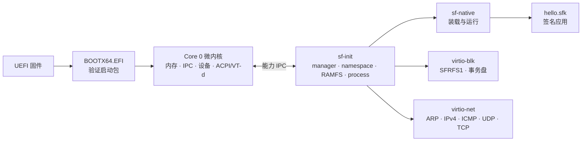

# SpiritFoxOS

[](https://github.com/fwqfzqaz/SpiritFoxOS/actions/workflows/linux.yml)
[](https://github.com/fwqfzqaz/SpiritFoxOS/actions/workflows/windows.yml)
[](docs/design/DESIGN-v0.2.md)
[](docs/project/ROADMAP.md)

面向 x86_64 UEFI 的**微内核操作系统原型**。Core 0 只保留内存、IPC、设备与 ACPI/VT-d；文件系统、驱动、native 运行时和网络协议运行在 ring-3 的 `.sfmod` 中；应用以签名 `.sfk` 包从只读磁盘验证后装载。

> 这是研究型原型，不是生产系统。当前完成到 M7 的网络纵向切片，完整边界见[实现说明](docs/architecture/IMPLEMENTATION.md)。

## 亮点

| 能力 | 当前状态 |
| --- | --- |
| 启动与隔离 | UEFI 验证签名启动包，ExitBootServices 后进入独立页表的 CPL3 `sf-init` |
| 调度 | 单核抢占、0–3 基础优先级、等待老化与同级轮转，PID 1 控制配置 |
| 包格式 | 96 字节头 + 64 字节段描述符 + 确定性 CBOR + Ed25519 尾部，W^X 与段布局校验 |
| 微内核边界 | 内核不解析路径、ELF、CBOR 或包格式；驱动与服务均为用户态模块 |
| 存储 | legacy/modern `virtio-blk`、SFRFS1 只读盘、双银行事务持久化、掉电故障恢复 |
| 更新与信任 | 应用 A/B 试运行、健康确认与回退、用途受限公钥、持久化密钥撤销、版本下限 |
| DMA 隔离 | QEMU q35 Intel VT-d，按设备授予有界 IOVA，拒绝越界 DMA |
| native 运行时 | static 与 `relative-v1` 位置无关装载、私有映像、有界 argv/env、有界 libc SDK |
| 文件 SDK | 有界 C 客户端封装文件 RPC，支持规范句柄、元数据、固定截止时间与只读目录委派 |
| 网络切片 | ring-3 legacy `virtio-net`、ARP/IPv4/ICMP、一次性 UDP/TCP，`ifconfig`/`ping`/`udp`/`tcp` |

## 架构



设计目标是“内核机制最小化、策略与服务用户态化”。当前把一个用户态二进制内的 manager、namespace、RAMFS 与 process 组合为 `sf-init`，协议边界仍以 IPC 与文件 RPC 保持。详见[设计说明 v0.2](docs/design/DESIGN-v0.2.md)。

## 快速开始

环境：Linux x64（使用系统 QEMU 与 OVMF），或 Windows x64 + Python 3.11+。工具链、缓存和密钥都在仓库内，无需全局安装或修改 `PATH`。

包作者可使用独立 `native-source-v1` schema 和无需密钥的离线清单检查；源文件界限与 `--strict-manifest` 用法见[清单说明](docs/architecture/MANIFESTS.md)。

```bash
python3 tools/bootstrap.py     # 下载并校验 Zig 0.13.0 与 Monocypher
python3 tools/test.py          # 构建 + 宿主/集成/QEMU 全量测试
```

常用变体：

```bash
python3 tools/build.py                 # 只构建
python3 tools/test.py --host-only      # 只跑宿主测试
python3 tools/test.py --skip-build     # 复用已有镜像
```

根目录 [Makefile](Makefile) 是同一套 Python 命令的薄封装：

```bash
make build          # 构建 EFI、模块、应用与测试盘
make test           # 完整测试
make run            # 交互启动
make run-persist    # 可写持久盘
make run-iommu      # 启用 VT-d
make qemu-list      # 列出单场景
make dist           # 全量测试后打包发布 ZIP
```

`make`、`make help` 会列出全部目标；`QEMU_ARGS`、`TEST_ARGS`、`PACKAGE`、`PYTHON` 可覆盖默认参数。

## 交互

```bash
python3 tests/qemu/qemu_test.py --interactive
python3 tests/qemu/qemu_test.py --interactive --persistent --iommu
```

进入系统后通过串口得到 `fox>`。常用命令：

```text
help
modules
ls /disk/bin
cat /disk/etc/readme.txt
run hello.sfk
run /disk/bin/diskhello.sfk
run argprobe.sfk alpha "two words" ''
write /persist/notes durable-note
install /disk/bin/diskhello.sfk
stat /tmp/notes
```

磁盘模式支持只读 `/disk` 与事务盘 `/persist`；RAMFS 在关机后清空。网络切片需要**无盘启动**（磁盘与网络共享固定 64 KiB DMA arena，只能授予一个驱动）：

```text
ifconfig
ping 10.0.2.2
udp 10.0.2.2 56001 hello
tcp 10.0.2.2 56002 hello
```

当前网络只支持 legacy virtio-net、轮询队列、静态 IP 与一次性 UDP/TCP 交换，无 IRQ、DHCP、连接对象或 `/net` 视图。

## 包工具

```bash
python3 tools/package/sfpack.py module --manifest echo.json --image echo.elf \
  --out echo.sfmod --seed .keys/development.seed
python3 tools/package/sfpack.py app --manifest hello.json --image hello.elf \
  --out hello.sfk --seed .keys/application.seed
python3 tools/package/sfpack.py inspect build/hello.sfk --trust-policy build/trust-policy.json
python3 tools/package/sfpack.py trust --policy build/trust-policy.json
```

当前支持固定地址 native 与静态链接的 `relative-v1` 应用；不支持资源包、动态导入、通用动态链接或压缩。只有应用清单显式声明 `namespace.read` 且通过 `runat`/`runenvat` 指定目录时，才会获得只读目录能力。

## 仓库结构

| 路径 | 内容 |
| --- | --- |
| `boot/` | UEFI 引导桩、ELF 重定位与 payload 链接 |
| `kernel/` | Core 0：入口、内存、IPC、设备、ACPI、VT-d |
| `services/` | ring-3 服务与驱动：init、namespace、package、txn、storage、trust、virtio、net、SDK |
| `include/` | 内核与服务共享的 ABI、结构与常量 |
| `tests/` | [宿主](tests/host)、[集成](tests/integration)、[QEMU](tests/qemu) 测试 |
| `tools/` | [构建/测试/打包](tools/README.md) 入口与包格式实现 |
| `docs/` | [设计、架构、质量与项目文档](docs/README.md) |
| `vendor/` | 固定版本 Monocypher 4.0.3 |
| `build/` | 忽略提交的镜像、日志与测试结果 |

`recovered/` 是重构前实现的冻结快照，仅供协议与算法参考，不参与构建。

## 验证

- 宿主：内核 IPC/内存/任务边界、文件 RPC、文件客户端 SDK、openat、截断、命名空间、事务与更新故障、信任撤销、IOMMU、版本策略，以及以宿主 glibc 为独立参照的 libc SDK 检查。
- 集成：包格式、SFRFS1、变异测试与构建脚本。
- QEMU：128/256/512 MiB 启动、签名验证、CPL3 服务、模块生命周期、持久化/更新/IOMMU/网络场景。
- 最近一次 `python3 tools/test.py --host-only` 在本机通过（约 50 秒）。

详细数量、环境与失败边界见[测试记录](docs/quality/TESTING.md)；安全审查见[SECURITY](docs/quality/SECURITY.md)。

## 当前状态与下一步

| 阶段 | 状态 | 下一步 |
| --- | --- | --- |
| M0–M2 | 包格式、CPL3、能力 IPC、模块依赖与有界监督 | 完整生命周期 RPC、能力转移/派生撤销、动态配额 |
| M3 | RAMFS、管道、poll、openat、只读目录委派、空目录回收 | proc/sys 适配、事件队列、符号链接策略、按进程挂载视图 |
| M4–M6 | native 运行时与文件客户端 SDK、SFRFS1、双银行事务与旧几何兼容、A/B 更新、VT-d、密钥轮换/撤销 | 通用现代设备、独立文件系统 sfmod、生产级信任与防回滚 |
| M7 | 网络纵向切片 | DHCP、网络 IRQ、连接对象、`/net`、磁盘与网络同时授权；图形、用户会话、多核 |

优先级：先补齐持久化服务与签名/更新策略，再扩展设备、网络和运行时能力。完整清单见[路线图](docs/project/ROADMAP.md)与[实施进度](docs/project/PROGRESS.md)。

## 已知限制

- 原型无 Secure Boot 配置、生产密钥或发布签名流程；不支持物理断电与真实硬件复位验证。
- 网络与磁盘互斥；VT-d 模式拒绝 legacy 设备；尚无 IRQ 重映射或通用设备隔离。
- 无图形、用户会话与多核支持；无通用硬件、virtio MMIO 或热迁移。
- 无动态链接、资源包、导入表或完整 POSIX 兼容层。
- `relative-v1` 提供有界基址切换，不是安全随机化；应用隔离依赖页表与 W^X，而非完整沙箱。

## 文档导航

| 文档 | 内容 |
| --- | --- |
| [设计说明 v0.2](docs/design/DESIGN-v0.2.md) | 目标架构、ABI 与安全模型 |
| [实现边界](docs/architecture/IMPLEMENTATION.md) | 当前真实行为与未完成项 |
| [命名空间](docs/architecture/NAMESPACE.md) / [存储](docs/architecture/STORAGE.md) | 文件对象、openat、SFRFS1 |
| [持久化](docs/architecture/PERSISTENCE.md) / [更新](docs/architecture/UPDATES.md) | 双银行事务、A/B 与回退 |
| [信任策略](docs/architecture/TRUST.md) / [native](docs/architecture/NATIVE.md) | 公钥用途、撤销、装载格式 |
| [文件 SDK](docs/architecture/FILE_SDK.md) / [项目状态](docs/project/STATUS.md) | 文件 RPC 客户端封装与当前交付状态 |
| [基础优先级](docs/architecture/SCHEDULING.md) | PID 1 配置、等待老化与同级轮转 |
| [生命周期](docs/architecture/LIFECYCLE.md) / [CPU 上下文](docs/architecture/CPU_CONTEXT.md) | 依赖代次、租约、FPU 隔离 |
| [测试记录](docs/quality/TESTING.md) / [安全审查](docs/quality/SECURITY.md) | 验证范围与已修复边界 |

欢迎通过 Issue 反馈问题；提交前请先运行 `python3 tools/test.py`，并保持 `-Wall -Wextra -Werror` 零告警。
