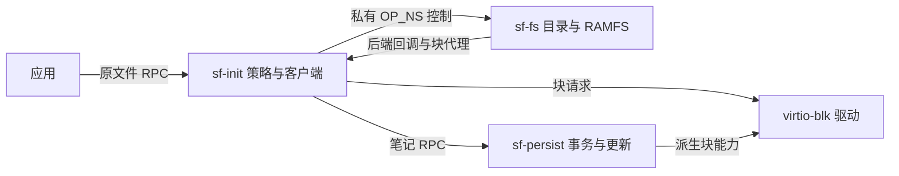

# 命名空间、目录能力与文件语义

本文件合并原目录能力说明与文件截断语义，覆盖 openat 委派、所有者权限、回收边界以及文件长度变更。

## P0 跨进程归属（2026-11-12 工作树，完整验证中）

目录、RAMFS、路径解析、节点/描述/服务端句柄表及 `/disk` 投影现在链接进独立 ring-3
`sf-fs.sfmod`。`sf-init` 保留文件 RPC 的身份/委派策略、128 槽 generation 映射和有界
客户端；`sf-persist.sfmod` 继续独占事务卷和更新状态机。实际 ELF 检查拒绝 Root 包含
`service_namespace`、磁盘解析器或事务状态机，确认大表分别在 Fs/Persist，并检查可写预算
与 1280 KiB 装载暂存上限。当前完整回归/推送状态见 PROGRESS。



### 控制通道与后端方向

`namespace_protocol.h` 追加控制操作 200–227、回调 240–247 和七位后端掩码；旧 602 项
ABI 原值保留，当前 646 项。控制通道由 Root 创建且不委派给应用。Fs 从第一条消息起固定
实际 RECV 发送者为 PID 1，核对内核身份与完整头部；Root 核对回复发送者、完整请求编号、
操作号和字段。传输返回实际发送者，业务错误和完整 32 位成功 seek 位置放在独立的
64 位 status 中。意外转移能力被关闭；等待、回调泵送和递归进入均有界。

挂载声明按有界字段分条传送，全部验证后原子发布，不序列化 C 对象或函数指针。应用仍只
持有原文件 RPC 能力，不能借私有操作号直接操作 Fs。Root 从认证应用 PID 选择 uid/gid/
委派根，Fs 在此可信控制通道中执行同一套路径和权限规则。

普通磁盘文件由 Fs 经 SFRFS1/SFRFS2 读取，每次读取（含定位 EOF）先回调 Root 检查驱动
存活。只有保留索引 UINT32_MAX 的笔记读写/截断返回 Root 的持久化适配器；普通磁盘索引
不允许通过该回调，防止重入同一 Fs。控制台、动态投影、挂载租约仍由 Root 提供。

### 独立磁盘生命周期与显式恢复

Fs 在无磁盘时即可启动，模块账本不再静态依赖磁盘驱动。挂载期间单独持有驱动租约；
卸载先关闭新挂载描述准入并拒绝 OPEN/DIRTY，移除 tag1 投影、停止磁盘视图和释放驱动
租约，不终止 Fs。因此 RAM/管道与其句柄在磁盘卸载、驱动停止/重启期间保持。

管理员可用 `namespace-status` 查看、`namespace-crash` 注入真实死亡、
`namespace-recover` 做一次有界重建。失联立即废弃远端绑定、保留客户端 generation 并
清空 Child.root。恢复拒绝尚在进行的 Root 装载/请求、DIRTY 和非命名空间 OPEN；只有
确认旧 PID 死亡后才撤销端点并对账已记录的命名空间描述（dup 仍只占一个描述）。
新服务的同整数句柄不能命中旧引用；旧应用不自动获得新目录根。

重建恢复易失树和已有账户的私有 home，账户表、会话身份、网络/图形状态保持；易失文件
内容不会跨 Fs 死亡保留。磁盘重新解析后，笔记用只读元数据重投影，绝不重放 persist
MOUNT 的 TRYING 回退。失败保持管理控制台可用，需显式再次恢复；一般健康/自动退避与
状态迁移仍为后续 P1。

Fs 不可用时，Root 为已登记应用提供一个有界的应急写控制台 token，保证普通 bundle
应用可输出并退出。token 只绑定该应用的实际 PID，使用命名空间槽范围之外的私有编号，
全局 generation 耗尽拒绝而不回绕；不提供目录根、读取或权限放大。每个应用最多一个
应急输出对象，不支持 dup，写入每消息最多 256 字节；正常命名空间路径不改变。恢复后
仍可关闭/写入该对象，原文件/目录引用保持失效。33,016 项实际文件 SDK/宿主检查验证
所有者、代次、宽度、坏请求无副作用与无新目录权；真实故障测试另验证控制台、whoami、
bundle 应用和显式恢复。

Root 对持久化 MOUNT/WRITE/TRUNCATE/INSTALL/BEGIN/FINISH/REVOKE 包围 DIRTY。
拒绝 SEND 或认证的完成回复才释放；不确定的在途完成保留租约，拒绝后续卷 RPC 和新包
执行，需要重新启动系统。不能仅重建命名空间来掩盖未排空写入，通用持久化服务恢复不在
本切片范围。语义明确的 COMMIT_UNCERTAIN 回复仍按原规则关闭卷并允许释放账本，之后
通过原磁盘重新挂载恢复。

## P0 迁移准备：命名空间写入边界（2026-11-10）

本节记录迁移前的历史基线：当时目录、RAMFS、句柄表和路径解析仍在 sf-init。当前归属见上文 P0 跨进程章节。管理器、磁盘与持久化客户端通过命名空间函数操作它们，不再直接写节点、打开描述或句柄表。

挂载先收集最多 128 项 `SfMountEntry` 声明，再调用 `sf_ns_mount_publish`。首项必须是非 `/` 的挂载目录，其余目录和磁盘文件必须位于该目录下，父目录先于子项出现；路径最多 95 字节、严格 UTF-8，重复路径、路径逃逸、错误父类型和节点容量不足均拒绝。声明是进程内受信任 C 接口，不是新的 IPC 消息或应用 ABI。

发布分两阶段：先验证全部声明、目标槽位、现有后代与打开引用，再一次性写入节点。失败不会改变任何命名空间节点、句柄、偏移或租约，也不会删除此前已有的空挂载目录。已有根目录必须未挂载、无后代、无打开描述；复用时保留其 uid/gid 和模式。父目录不存在或只读时不能创建新挂载根。磁盘客户端在格式读取、容量检查和全部条目收集成功后发布 `/disk`；持久化客户端以同一次发布建立只读 `/persist` 目录与可写笔记节点。共享底层存储的 mount tag 和最后描述释放规则保持。

`sf_ns_handoff` 仅供受信任管理器把一个已预留句柄绑定到新 PID：验证原所有者、槽号、generation 与目标非零所有者，保留句柄数值、共享描述、权限、偏移和挂载租约。原所有者随后不能再使用该句柄；其他 dup 别名的所有者保持。它没有加入文件 RPC，应用不能指定自己的身份或转交对象。启动后若内部交接失败，管理器杀死未登记子进程并释放预留目录和运行时租约。

宿主 `test_ns_mount.c` 的 256 项检查覆盖原子失败、节点耗尽、目录权限保留、只读发布、共享挂载标签、后端读取与交接/dup/回收/排空边界。完整回归和托管 CI 的实际结果见 [实施进度](../project/PROGRESS.md)。下一步仍需建立 sf-init 到 sf-fs 的认证有界客户端、后端回调代理与服务死亡/重启测试；本切片没有把进程内接口冒充跨进程隔离。

## 服务私有状态接口（2026-11-11）

`namespace.h` 对客户端只声明不透明的 `SfNamespace` 与函数接口；节点、描述、句柄和后端表布局位于 `services/namespace_state.h`，仅实现和明确的白盒宿主夹具包含。sf-init 不再分配表对象或依赖其大小，而是在初始化时取得 `sf_ns_default()` 的服务实现实例指针，再显式调用 `sf_ns_init`；反复取得指针不会重置对象。账户、文件 RPC 和存储客户端仍通过同一组函数访问。

2026-11-11 的此历史切片只改变模块内部表示边界，当时实例仍与 sf-init 同进程。服务搬迁和后端 RPC 仍按 P0 后续完成。22 项纯公有接口检查与 7 组真实编译检查覆盖可用指针/API、禁止客户端分配对象/sizeof/访问成员，以及三个私有布局类型不可见；完整验证状态见 [PROGRESS](../project/PROGRESS.md)。

## 投影元数据与偏移返回（2026-11-12）

服务端已有的 NODE_PROJECTION=6 现在由应用 SDK 的 SF_TYPE_PROJECTION=6 识别；目录权限与只读策略不变，stat 不再把合法类型 6 当成坏回复并永久停止客户端。元数据仍为原 32 字节 SfFileStat，投影 size=0、flags=1 保持。

sf_ns_seek、sf_file_dispatch 与 sf_file_dispatch_as 的 C 返回值和分发器局部状态使用 int64_t。原 Windows LLP64 宿主在合法定位至 UINT32_MAX 后，位置已改变却返回 -1；现在完整保留成功位置。freestanding x86_64 的消息 status 本来就是 64 位，操作号、消息布局和原有 guest 偏移边界没有改变。超过 UINT32_MAX 的投影 seek 仍拒绝且不改变共享偏移；定位读取不推进描述偏移。

## 目录能力与相对打开

日期：2026-10-24 的接口基线（服务归属现已按上文迁移）。内核只提供带真实发送者身份的 IPC。此阶段补齐受限 `openat` 与显式只读目录委派。

### 授权与使用

```text
run fileprobe.sfk                   # 无目录授权，探针退出 2
runat /tmp fileprobe.sfk            # 相对读取 notes
runat /disk/etc readprobe.sfk       # 相对读取 readme.txt
```

`runat <绝对目录> <应用>` 由受信任串口 shell 显式选择一个目录。应用必须是验证通过的 SFK，并在签名清单的 `requested_caps` 文本数组中精确声明 `namespace.read`。仅声明能力不会自动取得目录；普通 `run` 仍不授予目录。缺少声明、前缀相似的声明、非数组或混入非文本元素均不能取得授权；即使数组先包含正确声明，后面的非法元素也会导致拒绝。

授予的目录只有 `OPEN_READ | OPEN_DIRECTORY`。应用通过 `OP_ROOT` 取得自己的命名空间句柄，再使用 `OP_OPENAT` 打开相对文件或子目录。绝对 `OP_OPEN` 仍只允许 `/dev/console` 的写模式；没有隐含的全局文件根或当前工作目录。`fileprobe.sfk`、`readprobe.sfk` 是两个实际隔离应用，分别读取 `notes`、`readme.txt`，并验证路径逃逸、伪造句柄及写权限放大被拒绝。

sf-init 在创建进程前验证目录、保留打开描述和挂载引用；包验证、能力策略、运行时或进程创建失败会释放预留对象。创建成功后由服务把这个尚未公开的句柄绑定到新 PID，并登记进程；应用不能自行选择 PID 或绑定句柄。服务以内核返回的真实 IPC 发送者查找所有者，不接受消息中自报的身份。

当前通过根服务 RPC 引导目录句柄，`BootArgs.root_cap` 仍为 0；该句柄不是可调用内核端点的能力整数。BootArgs 和内核消息布局保持不变，完整独立 namespace/SDK 与能力传递 ABI 仍属后续工作。

### 消息接口

头部沿用协议 1.0 和固定 `SfMessage`。操作号为追加定义，既有操作号不变。

| 操作 | 请求 | 成功回复 |
| --- | --- | --- |
| `OP_ROOT (20)` | 无额外字段 | status=0，handle 为显式授予的目录；未授予或已关闭返回 SF_DENIED |
| `OP_OPENAT (19)` | handle=本进程目录；data=相对 UTF-8 路径；length 包含唯一末尾 NUL；mode=打开模式 | status=0，handle=新的进程内句柄 |
| `OP_ENUMERATE (18)` | handle=可读目录；length=输出容量，最多 256 | status 与 length 为实际字节数，data 为直接子节点名称，每项以换行结束 |
| `OP_ENUMERATE_AT (27)` | handle=可读目录；offset=零基子项序号；length=输出容量 | status 与 length 为单个名称字节数（含末尾 NUL），0 表示目录结束；容量不足返回 SF_NO_SPACE |
| `OP_STAT (23)` | handle=本进程有效句柄；length=0 | status=0，length=32，data为下述固定元数据；handle不变，错误length=0 |
| `OP_RMDIR (24)` | handle=可写目录；data=规范相对路径；length含唯一末尾NUL | status=0并保留目录handle；仅回收无引用、无后代的未挂载RAM目录 |
| `OP_UNLINK (22)` | handle=可写目录；data=规范相对路径；length 包含唯一末尾 NUL | status=0，保留原目录 handle；仅删除无打开引用的 RAM 普通文件 |
| `OP_TRUNCATE (21)` | handle=可写普通文件；offset=新的 64 位长度 | status=0；只读目录派生的文件拒绝此操作，详见 `NAMESPACE.md` |
| `OP_READ/WRITE/CLOSE/SEEK/POLL` | 沿用现有文件句柄协议 | 权限、独立偏移、dup、挂载失效与退出清理沿用同一实现 |

`OPEN_READ=1`、`OPEN_WRITE=2` 是权限；`OPEN_NONBLOCK=4` 保留现有行为；`OPEN_DIRECTORY=8` 要求目标实际是目录，不会增加访问权限。`sf_ns_openat` 的目标读写位必须是父目录权限的子集。信任域内的服务可用可写目录进一步衰减权限，应用的 shell 委派目前始终只读。

同一目录反复打开文件得到独立偏移；dup 仍共享一个打开描述。打开子目录后再相对打开，继续执行权限衰减。读取、写入与列目录在使用句柄时也检查权限，不靠隐藏路径替代授权。

### 所有者与模式权限

多用户会话下，每个节点另存属主 uid/gid 与九位 rwx 模式。uid 0 绕过检查；其他用户按属主/同组/其他取 6/3/0 位，打开需要读(4)或写(2)位，目录另需执行(1)位，且从委派根到目标直接父目录的每一层目录都必须授予执行。创建与删除要求直接父目录的写+执行位，卸载/只读/打开引用检查保持原有顺序。默认目录 0755、文件 0644；`/home/<name>` 为 0700，`/tmp` 为 0777（无 sticky 位），`/dev/console` 与 `/run/pipe` 为 0666。文件 RPC 由真实发送者 PID 映射到子进程的 uid/gid 后调用 `sf_ns_open_as/openat_as/unlink_as/rmdir_as`；shell 命令使用当前会话身份。账户、会话与权限模型见 [SESSIONS.md](SESSIONS.md)。

### 路径边界与生命周期

- 相对路径不得为空或以 `/` 开头；拒绝 `.`、`..`、重复分隔符、尾随斜线、非法 UTF-8 和嵌入 NUL。当前严格拒绝而不归一化这些形式。
- 完整绝对路径最多 95 字节，不含末尾 NUL；合并目录前缀与相对路径时先检查容量。多字节 UTF-8 以字节计长。
- 目录来自本进程的有效目录句柄；其他 PID 的句柄、旧 generation 和普通文件句柄不能充当目录。
- 没有符号链接、重命名和按进程挂载视图。解析使用被句柄固定的目录对象和规范路径；未来增加别名机制时必须重新审查此边界。
- 父目录和每个打开子对象各自持有挂载引用。关闭父目录不会撤销已打开子文件；子文件继续有效并阻止卸载。关闭初始根目录后，OP_ROOT 不重新授予它。
- 正常退出、页故障、超时和失败都会按 PID 回收全部命名空间句柄；目录/文件租约清零后才能卸载。关闭父目录不等同于派生树撤销，本轮未实现家族撤销或跨进程文件能力转移。

持久化文件的失效检查同样适用于 openat：设备死亡后不能从文件句柄读取缓存数据。`runat` 执行 installed 入口仍共用原先的 TRYING/确认/回退流程，不绕过更新策略；普通已安装包若没有声明 namespace.read，会被目录委派策略拒绝。

### 验证

`tests/host/test_openat.c` 直接链接真实命名空间实现，108 条检查覆盖目录类型、相对路径、所有者与 generation、权限衰减、Unicode/长度边界、独立和共享偏移、父关闭、进程回收、排空拒绝、描述与退休句柄容量，以及失败时挂载引用不泄漏。

包测试增加签名请求能力用例，验证十种数组/类型/精确匹配情况以及错误公钥拒绝。`tests/qemu/qemu_openat_test.py` 在 legacy 和 VT-d/modern 各启动一个真实 VM：普通运行拒绝目录访问，显式运行成功，连续 40 次故意遗留文件句柄仍可卸载，页故障/超时回收后驱动可重启并重新读取。已有可写盘安全 VM 另验证 `/persist/notes` 的只读委派、盘字节不变及驱动死亡后的读失败。

完整回归仍由 `python3 tools/test.py --skip-build` 执行；发布门要求 openat 宿主与 VM 标记，并校对精确 EFI/盘/公钥摘要。未实现的通用文件授权、创建/写入委派、符号链接、动态挂载视图、家族撤销与完整 SDK 继续保留在路线图中。

最终产品源码构建后完整回归通过（320.67 秒），共 79 个 VM；日志 `build/openat-final-test.txt`，机器结果包含 `openat_host_assertions=108` 与 `openat_qemu=true`。实际打包前还验证缺少 openat 标记的旧结果被拒绝。

### 文件 RPC 的数据边界

内核 SYS_SEND 原有检查已经拒绝 length>4096，消息不会进入服务队列。服务现在另用 sf_file_dispatch 独立检查 OP_READ、OP_WRITE、OP_ENUMERATE、OP_ENUMERATE_AT 的长度；超过 SfMessage.data 时返回 SF_INVALID、响应 length=0，且不调用后端，不改变文件偏移、节点、目录根或控制台状态。目录游标另限制 offset 不超过节点容量（128），越界序号返回 SF_INVALID。内部直接调用必须遵守同一边界。

OP_OPEN/OP_OPENAT 保持有界完整 NUL 字符串规则；合法读写最多 4096 字节，枚举允许返回不超过请求容量的完整条目。关闭委派根不会撤销已独立打开的子文件，进程回收仍关闭所有引用。协议代码在 services/file_rpc.c，与消息接收、发送和 Child 身份查找分开；这没有新增能力转移或通用服务并发路由。

364 项宿主检查直接调用产品分发器，包含跨消息数据区的保护字节、最大长度、失败前置拒绝、目录游标序号/容量/类型边界、偏移与节点字节保持、只读授权和根关闭。旧分发器宿主基线绕过了内核传输约束，其失败只证明服务自身缺少独立检查。真实 rpcprobe.sfk 检查 SYS_SEND 拒绝四种超长尺寸，再完成正常读写，避免把已由内核阻断的请求描述成曾能到达服务的漏洞。

### 当前请求与回复通道

| 用途 | 请求端点 | 回复端点与生命周期 |
| --- | --- | --- |
| 应用文件对象 | 独立 fs_ep，应用只有 SEND | 每个 Child.reply，应用只有 RECV，进程回收时撤销 |
| native 装载 | runtime_ep，root 发送 | 独立 runtime_reply，运行时重启时撤销重建 |
| 块设备 RPC | driver_ep，root 发送 | 每个驱动实例的 driver_reply，启动失败或正常停止时撤销 |
| Echo | 每个实例的服务端点，root 发送 | 每个 EchoPeer 的 reply，停止/替换/临时实例清理时撤销 |

channel-test 同时启动两个有只读 /disk/etc 根的 readprobe，完成各自打开、列举、读取、关闭及进程回收。首次启动或重新挂载后缓存为空，此路径会实际等待块设备回复；应用请求留在 manager 队列，不会被块 RPC 等待误取。该命令用于开发验证，要求磁盘已挂载。没有新增跨服务能力传递或并发更新事务。

echo-channel-test 在等待两个文件应用前同步调用 echo，用于验证两类请求均完成。echo-capacity-test 暂停 echo、实际耗尽并释放 root 的端点能力槽，验证两条启动分配失败路径与恢复。它们是当前单线程开发环境的诊断命令，要求正常回显服务及已挂载磁盘，不提供普通应用的特权接口。

### RAM 文件删除与目录创建

受信任串口 shell 提供 `rm <绝对路径>` 与 `mkdir <绝对路径>`，每条只接收一个参数，支持引号及原有参数词法中的转义，不进行变量或通配符展开。例如 `mkdir "/tmp/quoted dir"`、`mkdir /tmp/work`、`write /tmp/work/item data`、`rm /tmp/work/item`。现有 write 命令仍按首个空格分隔路径与文本。

`rm` 打开直接父目录的可写目录句柄，调用同一用户态 `sf_ns_unlink` 后关闭它；失败也关闭父目录。`mkdir` 调用既有受信任 `sf_ns_create`，目录必须具有已存在且可写的直接父目录。路径最多95字节，只接受规范绝对形式；节点容量为128（系统投影占用9个），描述表64、句柄表128；任一容量用满时返回 SF_NO_SPACE。新目录可以列举和创建子节点，空目录删除规则见下节。

`OP_UNLINK` 使用与 OPENAT 相同的精确 NUL/长度边界与相对路径合并。操作首先验证所有者、代次、目录类型和 OPEN_WRITE；只读委派返回 SF_DENIED，即使目标已被打开。随后重新检查目录对象、相对路径经过的现有中间目录及目标的 readonly/mount_tag。不能从较宽的目录能力穿过只读或挂载子树删除目标。没有符号链接或别名解析。

只允许删除未挂载的 NODE_FILE。目录、管道、控制台和未挂载的磁盘对象返回 SF_INVALID；只读或挂载目标返回 SF_READ_ONLY。任何进程的任何打开描述仍引用目标时返回 SF_BUSY，dup 或其他进程的独立打开同样阻止删除。服务串行处理打开、删除与回收，确认没有引用后才清空节点，重用槽不会把旧文件句柄绑定到新文件。重新创建得到零长度、已清零的数据区；已关闭句柄仍因 generation 不符而失效。

普通应用仍只取得只读目录，不能借新增操作修改 RAM 或持久化内容。真实 fileprobe/readprobe 在持有子文件时通过 IPC 尝试删除，必须得到 SF_DENIED，然后继续读取并由进程退出回收。没有增加普通应用可写目录授权、孤儿打开文件、rename 或持久化删除；`/persist/notes` 仍用原有读写/截断事务接口。

`tests/host/test_unlink.c` 直接链接产品 namespace/file_rpc，检查能力和类型、当前只读子目录、挂载拒绝、跨所有者/dup忙引用、规范路径、Unicode/长度边界、一千次槽复用与数据清零、陈旧句柄和畸形RPC无副作用。`tests/qemu/qemu_unlink_test.py` 在两种传输中验证实际shell与只读应用IPC、每种四十次节点复用、引号、持久盘字节和卸载停止。

### 只读系统投影

`/proc`、`/sys` 与 `/net` 下共挂载九个只读投影文件和 `/proc/self` 目录：`/proc/uptime`、`/proc/ipc-stats`、`/proc/self/status`、`/proc/children`、`/sys/modules`、`/sys/devices`、`/sys/dma`、`/net/info` 与 `/net/connections`。它们使用独立类型 6，不缓存内容；每次顺序读或定位读都由 sf-init 依据既有授权快照（ticks、IPC 统计、任务状态/配额、模块表、PCI 配置、DMA 状态、网络租约/计数、连接对象表）即时生成至多 1 KiB 文本。`size` 为 0、`flags` 只置只读位，`seek` 可设置任意 32 位偏移，越界读取返回 EOF。

投影节点不能写入、截断、删除或重命名，也不能通过父目录创建新节点；`/proc`、`/proc/self`、`/sys` 与 `/net` 目录本身在启动完成后受只读保护。投影不引入新的内核系统调用或能力，仍只由受信任的 sf-init 解释路径，普通应用没有全局根，不能直接读取这些文件。

`tests/host/test_projection.c` 覆盖投影创建、重复 id、顺序/定位读、EOF、seek、只读标志、拒绝写入/截断/删除、目录保护与节点容量；`tests/qemu/qemu_projection_test.py` 在真实内核中验证投影的列举与读取、实时文本、目录保护和重复读取。

### 句柄元数据与规范整数

`OP_STAT` 只操作调用者已持有的句柄；只写描述也可查询，不授予额外读写权限。固定32字节 `SfFileStat` 在此x86_64协议中按小端整数编码：

| 字节偏移 | 字段 | 语义 |
| --- | --- | --- |
| 0 | bytes:u32 | 固定32 |
| 4 | type:u32 | 1目录、2RAM文件、3管道、4控制台、5磁盘文件、6只读系统投影 |
| 8 | mode:u32 | 本打开描述的实际OPEN_*位，含权限与模式 |
| 12 | flags:u32 | 1节点只读、2挂载对象、4可定位；其他位为零 |
| 16 | size:u64 | 当前文件长度或管道排队字节；目录/控制台为零 |
| 24 | offset:u64 | 此打开描述的当前位置，dup观察同一偏移 |

节点只读标志与描述权限分别报告：只读委派可以指向可写RAM节点，但mode没有OPEN_WRITE；不能借flags为零扩大权限。记录不包含所有者、对象索引、路径、地址或后端指针。查询不读取后端、不改变偏移、不取得新引用；磁盘数据是当前缓存的元数据，不能用成功返回判定设备仍在线。新开句柄仍受原有挂载准入限制。

受信任shell提供 `stat <单个绝对路径>`，支持引号，打开只读描述，查询后关闭；错误也回收描述。输出为数值type/size/offset/mode/flags。普通应用不能通过此协议传入路径，只能查询自己的有效句柄。未知所有者、旧代次、关闭或回收的句柄返回SF_STALE_HANDLE，错误不输出元数据；非空STAT输入返回SF_INVALID且length=0。

SfMessage.handle的传输存储是64位，命名空间句柄规范值仍为32位。所有消费句柄的文件操作要求高32位为零，在窄化、后端访问和根关闭记账前拒绝，否则SF_STALE_HANDLE、length=0，保留原handle与根状态。OP_ROOT和受限OP_OPEN不消费传入的handle，按原协议处理。原所有者与generation验证继续执行；新增操作号不改变原有合法32位句柄。


### 空目录回收

受信任shell提供 rmdir <单个绝对路径>，支持引号；打开直接父目录的可写目录描述，调用sf_ns_rmdir并在成功或失败后关闭。它与rm共用精确路径/权限/当前只读和挂载祖先检查，OP_RMDIR(24)也要求规范32位句柄、唯一末尾NUL及长度边界。普通应用仍只授予只读目录；真实fileprobe/readprobe通过IPC发出的RMDIR必须返回SF_DENIED，即使目标实际为文件也不能越过权限检查。

只有NODE_DIR可回收；只读或挂载对象返回SF_READ_ONLY，其他类型SF_INVALID。任何进程的打开描述、dup或目录委派仍引用目标时SF_BUSY。检查所有32个节点：只要存在以目标路径加斜线为前缀的后代，即返回SF_BUSY；前缀相似的相邻名称不阻止删除。检查完成才清空槽，避免旧目录能力变为对新节点的访问。根目录不能作为任何规范相对路径的目标，也不提供递归删除。

该操作只回收空RAM目录，不修改持久化格式、挂载租约或普通应用授权。宿主覆盖一千次目录/子文件复用、跨所有者忙引用、陈旧句柄、规范/UTF-8边界、只读/挂载拒绝及高位/畸形RPC无副作用；实际VM覆盖嵌套非空拒绝、引号、前缀边界、四十次回收和真实只读应用拒绝。完整回归结果见TESTING.md。

公开客户端 `include/sf_file.h` / `services/file_client.c` 封装既有文件 RPC，采用显式 int64_t 返回并验证发送者、协议、编号、长度和输出；服务端仍独立检查所有者/代次/权限。普通 run 不授予文件根，显式目录委派仍只读，契约见 [APP_SDK.md](APP_SDK.md)。

### 重启句柄映射：迁移准备，尚未接入运行时

`services/namespace_handles.c` 是管理器私有的有界句柄映射，供 P0 的后续 RPC 客户端使用。128 个槽分别保存客户端所有者、23 位 generation 和服务端句柄；这些记录不是消息格式或共享 ABI。管理器整个存活期只构造一次映射，服务死亡时清除绑定并推进 incarnation，保留 generation；槽代次用尽后永久退役，incarnation 用尽后拒绝新绑定，均不回绕。

准备操作只返回槽快照；成功的 OPEN/DUP 回复确认后才能提交。快照不是锁或请求编号，后续传输层仍须串行化请求、验证真实发送者和编号；同槽复用或服务重启后的快照不能提交。查找先验证完整 64 位输入、所有者和 generation，失败不改输出。handoff、reap 和关闭只操作当前绑定，不能替代服务端的权限检查、关闭或租约回收。服务端重启即使再次发出相同的整数句柄，客户端旧句柄也不会转指新文件。

宿主门禁包含 502975 项映射检查与 24996 项实际 namespace 实现检查，后者执行一千次服务状态重建，并验证重复服务端整数、旧引用拒绝、dup 共享偏移和双端所有者交接。它们是宿主状态重建测试，尚不是独立进程死亡、真实 IPC 或恢复租约的 QEMU 证明。当前 sf-init 仍使用原本的进程内命名空间；接入 RPC、回调和独立于磁盘挂载的服务生命周期后才可宣称完成迁移。

### /disk 的文件系统后端

`/disk` 节点、目录租约、只读权限和挂载/卸载状态仍由 sf-init 的命名空间服务维护；磁盘条目、路径查找和分块读取改由独立 `sf-fs.sfmod` 提供，经 `OP_FS_ENTRY`、`OP_FS_FIND` 与 `OP_FS_READ` 投影为类型 5 的只读节点。应用和 `runat` 看到的句柄语义、挂载引用计数与卸载阻塞规则不变，也没有新增应用可调用的磁盘操作码。sf-fs 不直接持有 virtio-blk 端点，块数据由 sf-init 的块代理转发，设计见 [STORAGE.md](STORAGE.md)。

## 文件截断与补零扩展

日期：2026-10-23。RAMFS 普通文件和 `/persist/notes` 支持显式改变文件长度；write 仍只覆盖写入部分并保留其余尾部。

```text
write /persist/notes abcdefghij
truncate /persist/notes 4       # 内容为 abcd
truncate /persist/notes 12      # 保留 abcd，后八字节补零
truncate /persist/notes 0       # 清空
```

shell 的 `truncate <现有路径> <字节数>` 只接受无符号十进制数字，检查 64 位溢出；不接受符号、后缀或额外参数，不隐式创建命名空间节点。RAMFS 上限为 1024 字节，笔记上限为 16384 字节。`/persist/notes` 是始终存在的虚拟文件，首次空文件截断到 0 不必创建事务键。

### 句柄与权限

`sf_ns_truncate(namespace, owner, handle, length)` 验证所有者、generation、写权限和目标类型。只读句柄返回 SF_DENIED，只读节点返回 SF_READ_ONLY，目录、管道和控制台返回 SF_INVALID。长度超出容量返回 SF_NO_SPACE；不在失败后发布新的节点长度。

操作只改变文件长度，保留所有打开描述的偏移，包括 dup 共享的偏移。缩短后偏移可以位于 EOF 之后，此时读返回 0；之后在旧偏移写入时，中间空洞补零。RAMFS 缩短时清零丢弃的内存尾部，扩展部分也清零，防止后续扩展重新暴露被截掉的内容。

命名空间 RPC 追加 `OP_TRUNCATE=21`：handle 是已有文件句柄，offset 是新的 64 位长度；成功 status=0，失败为错误码。消息布局和已有操作号不变。`runat` 仍只授予读权限，应用不能利用 truncate 绕过只读目录策略。实际 fileprobe/readprobe 在获得只读文件后尝试截断，必须被拒绝，原数据仍可读取。

NODE_DISK 通过 `external_truncate(index, length)` 回调处理，回调只有返回 0 才表示成功；正数被视为格式错误。持久化适配器仅接受笔记索引，A/B 槽、更新选择器和只读磁盘文件没有公开可写截断入口。

### 持久化与恢复

`sf_txn_resize` 与实际用户态服务共用同一事务引擎。它保留新旧长度公共前缀，把扩展部分初始化为零，然后调用现有双银行快照提交；格式和配额不变。暂存数据在 commit 重建银行之前复制到 next 状态，不依赖旧尾部残留为零。

已挂载卷中的同长度请求直接成功，不写盘、不 flush、不提高 generation；尚不存在的空事务键视为适配器的空文件，截断到 0 也不改盘。设备死亡或卷已关闭时仍拒绝操作，不能用幂等请求绕过失效检查。

改变长度持有真实 dirty 引用，最后一次 flush 成功后才公布内存状态和节点长度。任何写/flush 失败返回 SF_COMMIT_UNCERTAIN，并停止该卷后续读写与截断；dirty 引用仍被释放，关闭文件后可卸载。重挂载只能恢复完整旧文件或完整新文件；错误本身不保证新文件一定未落盘。失败时命名空间暂留原长度，但数据访问已被关闭，恢复时重新构造节点。

笔记操作不会修改应用槽、更新记录或已确认版本。银行仍是整个卷的快照；旧银行可能保留旧内容，因此截断不是安全擦除。未来损坏导致回退旧的完整快照时，笔记也按该快照恢复。本轮没有改变既有回放/损坏恢复边界，也没有物理断电证明。

### 验证入口

- `tests/host/test_truncate.c`：83 条命名空间检查，覆盖写权限/类型、所有者与 generation、缩短/补零/空洞、偏移与 dup、容量、后端失败和节点长度只在成功后更新。
- `tests/host/test_resize_txn.c`：真实 resize 与事务引擎执行缩短、扩展、清空、首次扩展四种转换，每种覆盖 261 个写/flush 边界 × 三种故障模式，共 3132 个故障场景。验证恢复长度、字节、零区、同长度不改盘和三个独立保护文件。
- `tests/qemu/qemu_truncate_test.py`：legacy 与 VT-d/modern 各八次真实 VM 启动。验证缩短、零扩展、清空、最大容量、重启、同长度与非法请求不改盘、只读应用 RPC 拒绝、应用槽和选择器不变，以及实际 OUT/FLUSH EIO 和银行中段写入时终止 VM 后恢复。

完整套件继续由 `python3 tools/test.py --skip-build` 运行，增加到 95 次 VM 启动。发布门要求 `truncate_host_assertions=83`、`resize_fault_scenarios=3132`、`truncate_qemu=true` 以及全部已有标记和精确镜像摘要。

最终产品源码构建后完整回归通过（386.03 秒），实际日志计数为 95 个 VM，输出 `build/truncate-final-test.txt`。新增事务测试完成 474481 条内部检查及上述 3132 个有界故障场景；缺少本轮标记的旧结果被打包门拒绝。

## 文件入口对附加能力的所有权（2026-11-13）

`sf_recv` 成功返回时，附加能力已安装到 Root。文件入口在查应用 Child 表前关闭这次
收到的单个能力：未知对端返回 `SF_INVALID`；已知应用收到原有无附加能力的错误回复。
这样拒绝未知对端也会回收接收方的引用，不依赖对端随后退出。普通文件消息的 handle
是文件句柄，cap_count=0 时不得当作内核能力关闭。该修复未改变文件授权、公开 ABI、
包/磁盘格式或 Fs/Persist 的服务归属。

root 可执行 `file-peer-test`：由独立签名 `foreigncap.sfmod` 在活着且未登记为应用时
发送 64 次附加端点，逐次验证 Root 占用仅含一个临时控制端点，结束后回到原值。该模块
使用既有服务端点授权，不能作为普通应用运行；失败路径有界终止探针并撤销控制端点。
实际覆盖及完整/发布/托管状态见 PROGRESS 与 TESTING。
